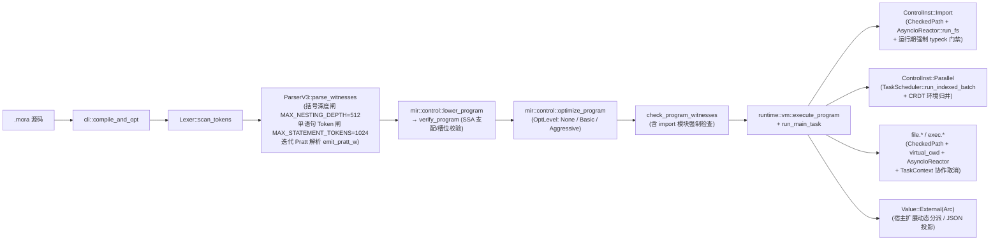

# Mora 架构图（v0.110.0 Wave 1–4 + P1/P2 收口现状）

> 本文档对应当前 `d:\Github\mora-lang` 代码库实际实现（`src/` 顶层模块 + `test_support`，外加独立 workspace crate `std/math/bigint` 与纯 Mora 标准库 `std/net/http.mora`、`std/mcp.mora`），标注 Wave 1–4 及 P1/P2 已落地的单一 Control SSA / AOT 字节码管线、计算图算子融合、零依赖硬件 GPU 后端与云原生并发运行时。

---

## 一、顶层分层架构

```mermaid
flowchart TD
    subgraph ENTRY["入口层 Binaries & CLI"]
        CLI["main.rs + cli/{mod,repl,bundle}.rs\nCLI runner / --check / --repl / build [--emit-bc] / install"]
        LSP_BIN["bin/lsp.rs\nLSP Server (mora-lsp)"]
    end

    subgraph FRONTEND["前端层 Frontend"]
        LEX["lexer.rs\n词法分析 → Token"]
        PARSE["parser_v3/\n迭代 Pratt 语法解析 (emit_pratt_w)\n→ MirWitness[] + 深度/Token 闸"]
    end

    subgraph IR_OPT["中间表示、优化与 AOT 字节码 Control SSA IR"]
        WIT["mir/witness.rs\nMirWitness 树 + 迭代 Drop/遍历"]
        HINT["mir/hint.rs\n类型与参数提示"]
        EFFECT["mir/effect.rs\nEffectRow + ambient 效果表"]
        CTRL_IR["mir/control/ir.rs\nControlProgram / BasicBlock / ControlInst\nControlTerminator + Purity + verify_program"]
        LOWER["mir/control/lower.rs\nMirWitness[] → ControlProgram 直接降出"]
        OPT["mir/control/opt.rs\nOptLevel (0/1/2): CopyProp / GVN-CSE / LICM / DCE"]
        CODEC["mir/control/codec.rs\nMORABC02 确定性 LEB128 字节码编解码 + FNV-1a 校验"]
    end

    subgraph TYPECK["静态类型检查层 (Stage 3A/3B/3C & Wave 4 统一 HM 求解器)"]
        CHECK["typeck/check_mir.rs\ncheck_program_witnesses (唯一入口)"]
        HM["typeck/hm/\nSpan 追踪 HM 约束求解 + Rigid 泛型 + row-poly + Value Restriction + 5 项 AI 检查"]
        DISPATCH["typeck/dispatch.rs\n方法/内建签名"]
        IMPORTS["typeck/imports.rs\n跨模块 export (含 struct/enum/trait/impl) 与菱形 import 传播"]
    end

    subgraph VM["单一执行内核 runtime/vm/"]
        VM_MOD["runtime/vm/mod.rs\nexecute_program / run_main_task / execute_value"]
        VM_ENGINE["runtime/vm/engine.rs\n堆帧 VM (Vec<CallFrame>)\nO(1) 尾调用 + 多发定界续延 + Import 门禁"]
        VM_CONT["runtime/vm/continuation.rs\nCapturedContinuation / CallFrame / ModuleGlobals"]
        VM_BUILTINS["runtime/vm/builtins.rs\n内建/模块/外部宿主/AD/DAG/KV/MemoryPool 分派"]
    end

    subgraph AI_RUNTIME["AI 原生计算图、高阶 AD、硬件 GPU 与资源调控"]
        AD["runtime/{autograd,autograd_higher_order}.rs\n多磁带任意阶 VJP/JVP/HVP + 反向图捕获"]
        DAG["runtime/{compute_dag,simd_kernels}.rs\nTensorComputeDag 4 遍融合 (FlashAttention/RmsNormLinear/LinearAct/Elementwise)\n+ DagMemoryPlan / DagPlanCache + AVX2/FMA & NEON 多线程内核"]
        GPU["runtime/gpu/{mod,cuda,vulkan,metal}.rs\n零依赖硬件 GPU 后端 (CUDA Driver+PTX 7.0 / Vulkan 1.0+SPIR-V / Metal MSL)"]
        KV_MEM["runtime/{kv_cache,memory_pool}.rs\nKVPageAllocator (CoW/配额/抢占/水位线) + 64B 对齐 Slab MemoryPool"]
    end

    subgraph RUNTIME["并发与宿主运行时 runtime/"]
        CORE["runtime/core.rs\nCoreRuntime + Arc<EngineShared> (scheduler / reactor / DagPlanCache / bundled_modules)"]
        SCHED["runtime/scheduler.rs\nTaskScheduler / MoraChannel / select_arms / MoraTaskHandle / TaskContext"]
        REACTOR["runtime/reactor.rs\nAsyncIoReactor (run_fs / run_blocking_io / MoraTcpListener / MoraTcpStream)"]
        FS["runtime/fs.rs\nFsPolicy (Unrestricted / Confined) / CheckedPath / virtual_cwd"]
        RAND["runtime/random.rs\n线程安全 PRNG 与 ambient random"]
    end

    subgraph BUILTINS_VALUE["内建域、值与基础底座"]
        BUILTINS["runtime/builtins/\n纯方法分发 + registry + domain modules ({file,exec,math,stats,linalg,traits})"]
        VALUE["value.rs + value/{list,display,tensor}.rs\nValue (Channel/TaskHandle/Context/Tcp/Tensor/ComputeDag/KVAllocator/MemoryPool)\nEnvironment: HashMap + Arc<Environment> 父链"]
        FLOW["flow.rs + flow/json.rs + flow/numeric/\n数值塔 / type_name / 统一 RFC 8259 迭代 JSON"]
        ERR["error.rs\nMoraError / MoraResult 统一结构化错误"]
    end

    subgraph STD_WS["Workspace 标准库包与纯 Mora 标准库"]
        BIGINT["std/math/bigint (纯 Mora)\n独立 BigInt 标准库模块"]
        HTTP_MCP["std/net/http.mora & std/mcp.mora\n纯 Mora HTTP/1.1 (Router/Chunked/Keep-Alive/SSE) 与 MCP JSON-RPC 2.0 标准库"]
    end

    ENTRY --> FRONTEND
    FRONTEND --> IR_OPT
    IR_OPT --> TYPECK
    IR_OPT --> VM
    TYPECK --> VM
    VM --> AI_RUNTIME
    VM --> RUNTIME
    VM --> BUILTINS_VALUE
    AI_RUNTIME --> BUILTINS_VALUE
    RUNTIME --> BUILTINS_VALUE
```

---

## 二、单一编译与执行主路径（数据流）

---

## 三、LSP 架构（`mora-lsp`）

- **入口**：[src/bin/lsp.rs](file:///d:/Github/mora-lang/src/bin/lsp.rs) 运行于 OS 默认栈，启动 `lsp::server::Server::new().run()`。
- **有界 stdio 分帧**：[src/lsp/transport.rs](file:///d:/Github/mora-lang/src/lsp/transport.rs) 强制执行 `MAX_CONTENT_LENGTH`（16 MiB）、`MAX_HEADER_LINES`（64）、`MAX_HEADER_LINE_BYTES`（8 KiB）与冲突 `Content-Length` 拒绝。
- **统一 JSON 内核**：[src/lsp/json.rs](file:///d:/Github/mora-lang/src/lsp/json.rs) 通过 `flow::json::parse_json_with` 复用唯一的显式栈迭代 RFC 8259 解析器（`MAX_JSON_DEPTH = 256`）与统一字符串转义，同时保留 LSP 数值线格式。
- **Provider 层**：[src/lsp/providers/](file:///d:/Github/mora-lang/src/lsp/providers/mod.rs) 提供诊断、hover、补全、跳转、引用、重命名、文档符号、格式化与语义高亮。

---

## 四、演进路标（Wave 3 & Wave 4 状态）

1. **Wave 3 — Stage 3A（已完成）**
   - 词法严格分离无后缀整/浮点字面量并支持科学计数法、下划线、位宽后缀校验与 `**`/`@`/`!`；
   - 废除双检查器，收口为单一 `Span` 追踪 HM 约束求解器（`check_program_witnesses`、`TypeVarId::{Rigid, Meta}`、`Type::Error` 隔离、fail-closed `Unknown`、`BuiltinModule`、协变 `Result_`、值限制与 `range`/`rand_int`/`shape` 返回 `Int`）。
2. **Wave 2 架构遗留收口（已完成，覆盖 `tests/w2_closure_concurrency_and_lsp.rs` 与 `tests/w2_tcp_networking.rs`）**
   - 废除 HAMT `value/persistent.rs` 与 `VectorClock`/`Conflict` 耦合，`Environment` 收敛为扁平 `HashMap<String, Value>` + `Arc<Environment>` 父链，并从 `CoreRuntime` 拆出进程级共享 `EngineShared { scheduler, reactor }`；
   - 彻底解散 `src/interpreter/` 与 `Interpreter` 门面，下沉至 `src/runtime/builtins/` 与 `src/cli/repl.rs`；
   - 将 Go 式并发原语（`spawn` / 不变 `channel<T>` / 协变 `task_handle<T>` / `select` / `context` / `sleep`）与非阻塞异步 TCP 原语（`tcp_listen` / `tcp_connect` / `tcp_listener` / `tcp_stream`）端到端打通至前端、`ControlProgram` IR、HM 类型系统与堆帧 VM；
   - 将 LSP hover / completion 统一接入 `typeck::check_mir::infer_program_types` 与真实内建/模块清单。
3. **Wave 3 — Stage 3B & Stage 3C（已完成，覆盖 `tests/stage3b_tensor_and_static_checks.rs` 与 `tests/stage3c_traits_structs_slices_autograd.rs`）**
   - Stage 3B：引入一等 `Tensor<DType, Shape, Device>` 与未擦除的 `f16`/`bf16`/`fp8`/`i8`/`i4` 硬件精度、64 字节对齐紧凑存储与 5 项静态检查（DType/Shape/Device/Resource/Effect）；
   - Stage 3C：落地名义 `struct`/`enum`/`@tag`、源码级 `trait`/`impl`/`dyn`、默认与命名参数、多维零拷贝 `TensorSlice` 与反向自动微分 `grad`/`value_and_grad`/`no_grad`。
4. **Wave 4（已完成，覆盖 `tests/w4_*.rs` 与 `tests/p2_hardware_gpu_backends.rs`）**
   - 原生 `TensorComputeDag`（`trace_dag`）、4 遍深度算子融合（`FusedFlashAttention` + `FusedRmsNormLinear` + `FusedLinearAct` + `FusedElementwise`）、`DagMemoryPlan`/`DagPlanCache`、`DeviceBackend` 硬件 GPU 后端（CUDA Driver+PTX 7.0 / Vulkan 1.0+SPIR-V / Metal MSL + SIMD `AVX2+FMA`/`NEON` 多线程 CPU），以及任意阶 AD（`grad`/`jvp`/HVP、`src/runtime/compute_dag.rs`、`src/runtime/simd_kernels.rs`、`src/runtime/gpu/`、`src/runtime/{autograd,autograd_higher_order}.rs`）；
   - PagedAttention 式显存页表管理器 `KVPageAllocator`（配额/优先级抢占/水位线回调）与 64B 对齐 `MemoryPool`（`src/runtime/kv_cache.rs`、`src/runtime/memory_pool.rs`）；
   - 跨模块 `export`（含 `struct`/`enum`/`trait`/`impl`/参数规范）与菱形 `import` 符号传播，纯 Mora 编写的 `std/net/http`（含 Router/Chunked/Keep-Alive/SSE）与 `std/mcp`（含 Prompts/Struct Schema/Stdio）标准库；
   - Go 式 `mora build <file.mora> [--emit-bc] [-o <out>]` 零源码 `MORABC02` AOT 字节码单二进制与 `.morac` 打包执行（`src/mir/control/codec.rs`、`src/cli/bundle.rs`）。
